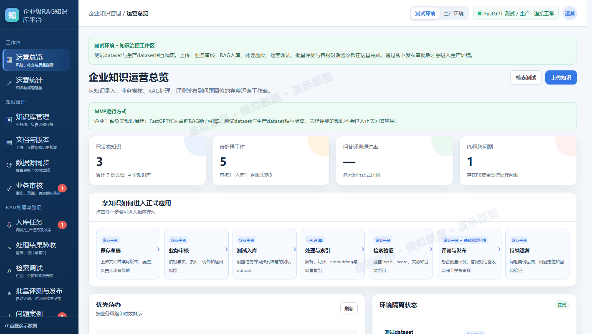
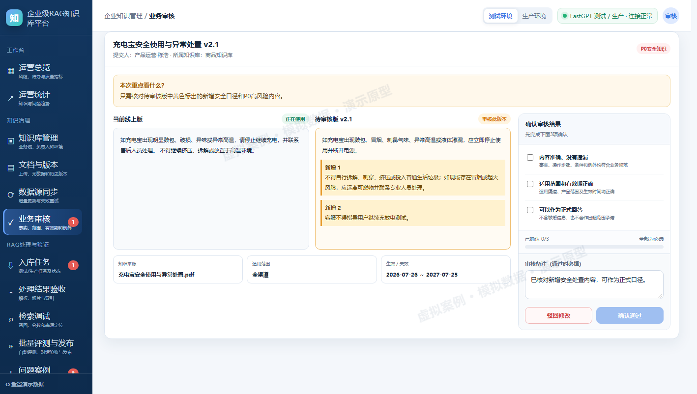
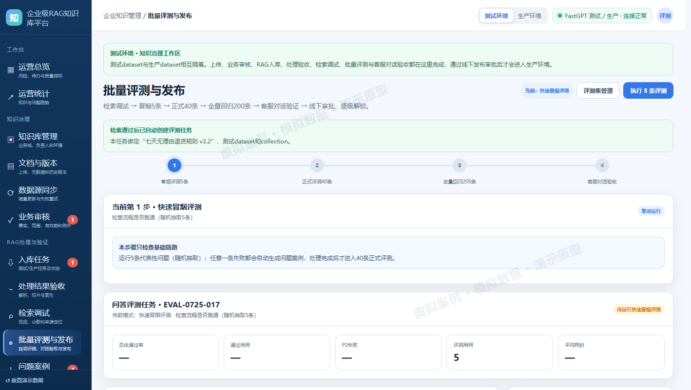
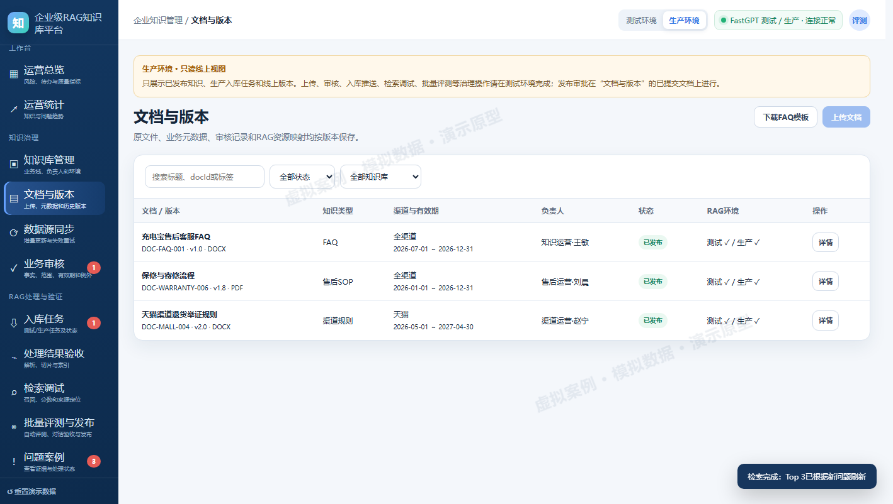

# 企业级 RAG 知识库平台

一个面向企业知识治理场景的产品作品集：把散落的政策、FAQ 与 SOP，变成**可审核、可发布、可评测、可追溯**的知识资产。

仓库包含两个版本：

| 版本 | 形态 | 用途 |
|---|---|---|
| **作品集版** | 静态站点 + 单文件交互原型 | 给招聘者浏览：项目案例页、可点击原型 |
| **真实项目版** | Node.js 全栈应用（SQLite + Dify） | 本地真实运行：文件上传、切片、检索、评测、发布 |

> 所有企业、文档、评测与问题案例数据均为**虚拟案例与模拟数据**；真实项目版用于本地验证与作品演示，未在真实企业上线，不代表生产 SLA。

---

## 一、作品集版

```
作品集版/
  index.html                 作品集首页（主项目：企业级 RAG 知识库平台）
  RAG知识库平台案例.html      完整项目案例（问题 / 方案 / 验证 / 判断 / 边界）
  RAG知识库平台-交互原型.html 可交互原型（单文件，双击即开）
  assets/                    案例截图
  问需案例.html / 其他实践.html / cross-border-demo.html
```

打开方式：直接双击 `作品集版/index.html`（无需服务器）。

原型覆盖 13 个页面：运营总览、运营统计、知识库管理、文档与版本、数据源同步、业务审核、入库任务、处理结果验收、检索调试、批量评测与发布、问题案例、权限与审计、RAG 引擎配置。

---

## 二、真实项目版

```
真实项目版/
  server/            Node HTTP 服务、SQLite、鉴权、RBAC、Dify 适配、本地降级引擎
  web/               前端（原生 ES Modules，复用原型视觉与交互）
  tests/             node:test 单元测试
  start.cmd          Windows 一键启动
  .env.example       配置模板（复制为 .env 后填写）
```

### 快速开始

1. 安装 [Node.js](https://nodejs.org/) 22.5 或更高版本；
2. 双击 `真实项目版/start.cmd`（或项目根目录 `打开真实项目版.cmd`）；
3. 浏览器打开 <http://127.0.0.1:8787>。

演示账号（密码均为 `demo1234`）：

| 账号 | 角色 |
|---|---|
| operator | 知识运营 |
| reviewer | 业务审核人 |
| tester | AI产品经理 |
| approver | 发布审批人 |
| admin | 系统管理员 |

> 这是 Web 应用，**不要直接双击 `web/index.html`**；必须通过 `start.cmd` 启动本地服务后访问。

### 真实能力

- 真实文件上传（PDF / DOCX / TXT / MD / CSV / HTML）与落盘存储；
- 业务审核三项确认；提交人与审核人分离（服务端强制）；
- 对接 **Dify**：自动创建测试/生产 dataset、上传文档、索引状态轮询、拉取真实切片、检索、LLM 回答；
- 未配置 Dify 时自动降级为本地引擎（BM25 + 抽取式回答），全流程仍可运行；
- 评测门槛：冒烟 5 / 正式 40 / 全量回归 200 / 客服对话验收；问题案例阻断发布；
- 审批发布写入生产 dataset；五角色权限、审计日志、运营统计。

### 配置 Dify（可选）

```bash
cp 真实项目版/.env.example 真实项目版/.env
```

填写 `DIFY_BASE_URL`、`DIFY_DATASET_KEY`（数据集 API Key）与 `DIFY_COMPLETION_KEY`（文本生成或聊天应用 Key）。也可以启动后在「RAG 引擎配置」页面填写。

> `.env` 含真实密钥，已被 `.gitignore` 排除，请勿提交或分享。

### 测试

```bash
cd 真实项目版
npm install
npm test
```

---

## 三、效果预览

| 运营总览 | 业务审核 |
|---|---|
|  |  |

| 批量评测 | 生产只读视图 |
|---|---|
|  |  |

---

## 四、技术栈

- 前端：原生 HTML / CSS / JavaScript（ES Modules），无框架、无构建链；
- 后端：Node.js 24 内置 `http` + `node:sqlite`；
- RAG：Dify Dataset API + 文本生成/聊天应用；本地降级 BM25；
- 测试：`node:test` + 无头浏览器端到端检查。

## 五、边界与合规

- 企业与业务数据为虚拟案例，页面已标注「模拟案例 · 模拟数据」；
- 不含任何真实企业的生产数据、客户信息或未公开资料；
- 本项目仅用于个人作品展示与学习，不代表任何企业的官方系统。
